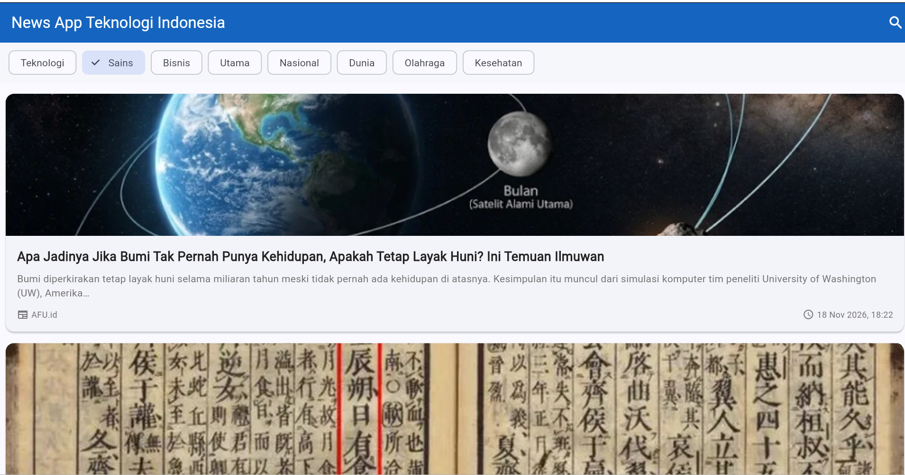
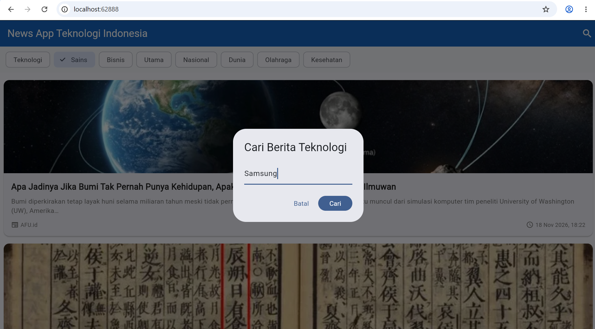
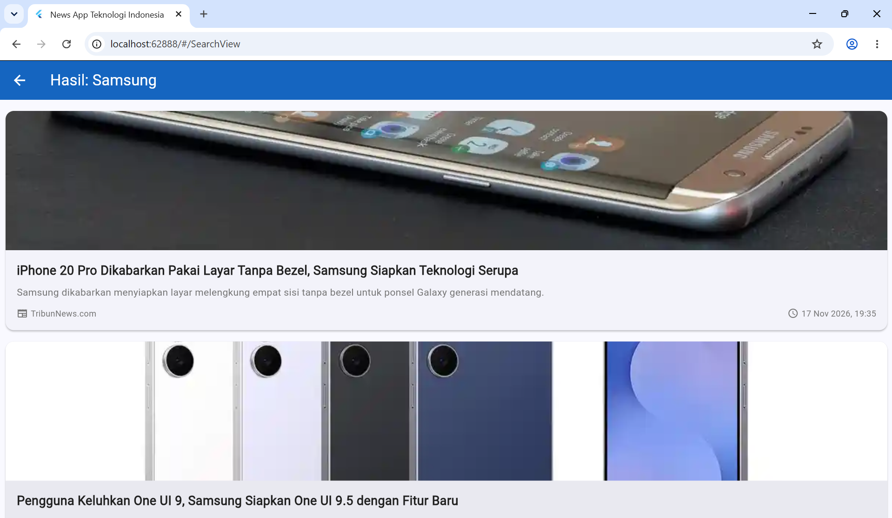
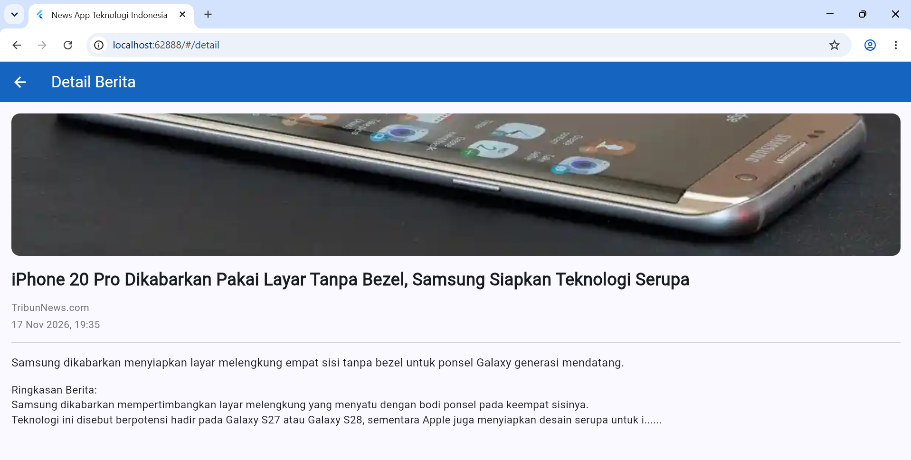
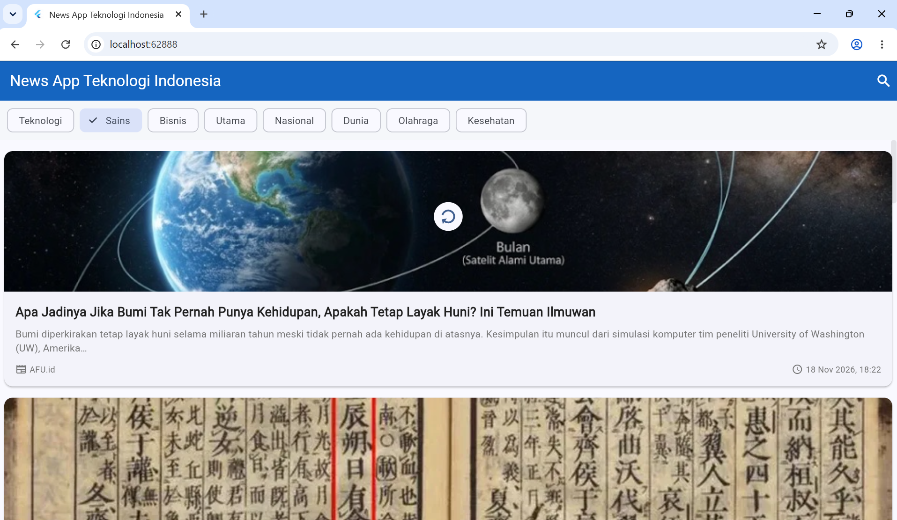
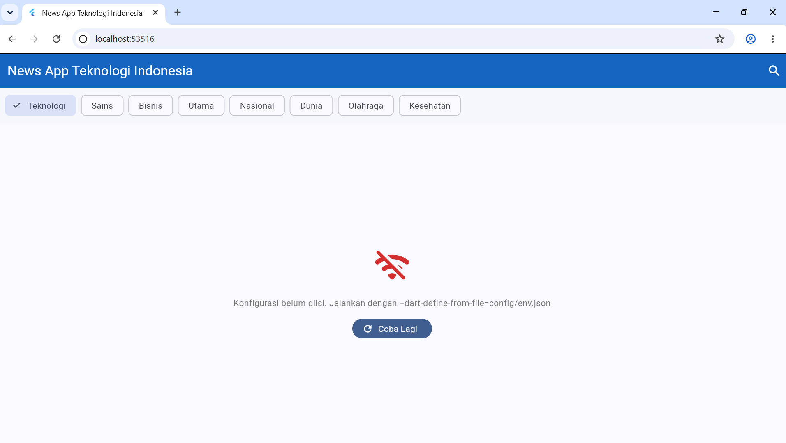
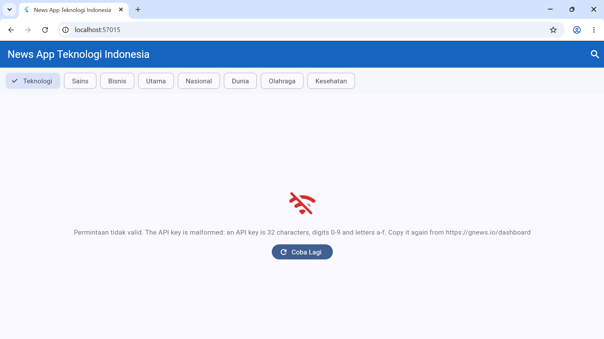

# News App Teknologi Indonesia

Aplikasi berita berbasis Flutter yang menampilkan berita terkini menggunakan GNews API. Project ini dibuat untuk memenuhi tugas Topic 11: FutureBuilder, News App & Error Handling API di Flutter.

## Fitur Aplikasi

- Menampilkan berita dari GNews API.
- Menggunakan FutureBuilder dengan empat state: loading, error, empty, dan data.
- Memilih kategori berita seperti Teknologi, Sains, Bisnis, dan lainnya.
- Mencari berita berdasarkan kata kunci melalui dialog pencarian.
- Menampilkan hasil pencarian pada halaman baru dengan FutureBuilder.
- Menampilkan halaman detail berita.
- Memperbarui berita menggunakan pull-to-refresh.
- Menyimpan Future berdasarkan kategori menggunakan Map agar mengurangi permintaan API.
- Menangani kesalahan API menggunakan ApiException.
- Menyediakan tombol Coba Lagi untuk mengulang permintaan yang gagal.

## Teknologi yang Digunakan

- Flutter dan Dart
- GNews API
- Dio
- GetX
- Intl
- Cached Network Image

## Cara Menjalankan

1. Clone repository.
2. Jalankan `flutter pub get`.
3. Salin `config/env.example.json` menjadi `config/env.json`.
4. Isi konfigurasi dengan URL GNews API dan API key milik sendiri.
5. Jalankan aplikasi:

```bash
flutter run -d chrome --dart-define-from-file=config/env.json
```

API key asli tidak disertakan dalam repository untuk menjaga keamanan.

## Screenshot Aplikasi

### 1. Halaman Utama


### 2. Kategori Sains



### 3. Dialog Pencarian



### 4. Hasil Pencarian



### 5. Detail Berita



### 6. Pull-to-Refresh



## Pengujian Error Handling

### Skenario 1: Konfigurasi API Tidak Lengkap

Aplikasi menampilkan pesan kesalahan ketika konfigurasi API belum diberikan.



### Skenario 2: API Key Salah Format

Aplikasi menampilkan pesan kesalahan ketika GNews menolak API key yang tidak sesuai format.



Kedua skenario menampilkan tombol Coba Lagi untuk mengulang permintaan.

## Struktur Project

- `lib/models/` — Model data artikel dan respons API.
- `lib/services/` — Layanan GNews API dan ApiException.
- `lib/views/` — Halaman utama, pencarian, dan detail berita.
- `lib/widgets/` — Komponen tampilan yang digunakan kembali.
- `lib/controllers/` — Controller halaman detail.
- `lib/routes/` — Pengaturan navigasi GetX.
- `lib/utils/` — Warna aplikasi dan format tanggal.
- `lib/config/` — Pembacaan konfigurasi API.
- `screenshoots/` — Dokumentasi screenshot aplikasi.

## Catatan

Project ini dibuat untuk tugas praktikum Pemrograman Mobile Topic 11.
